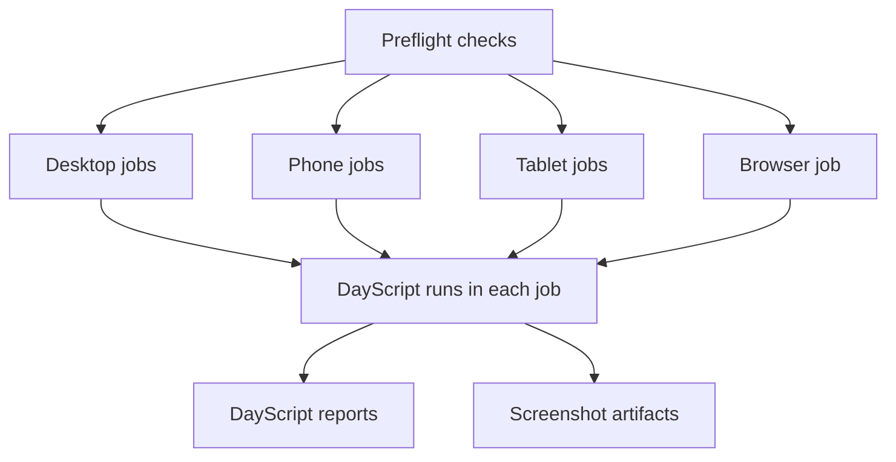
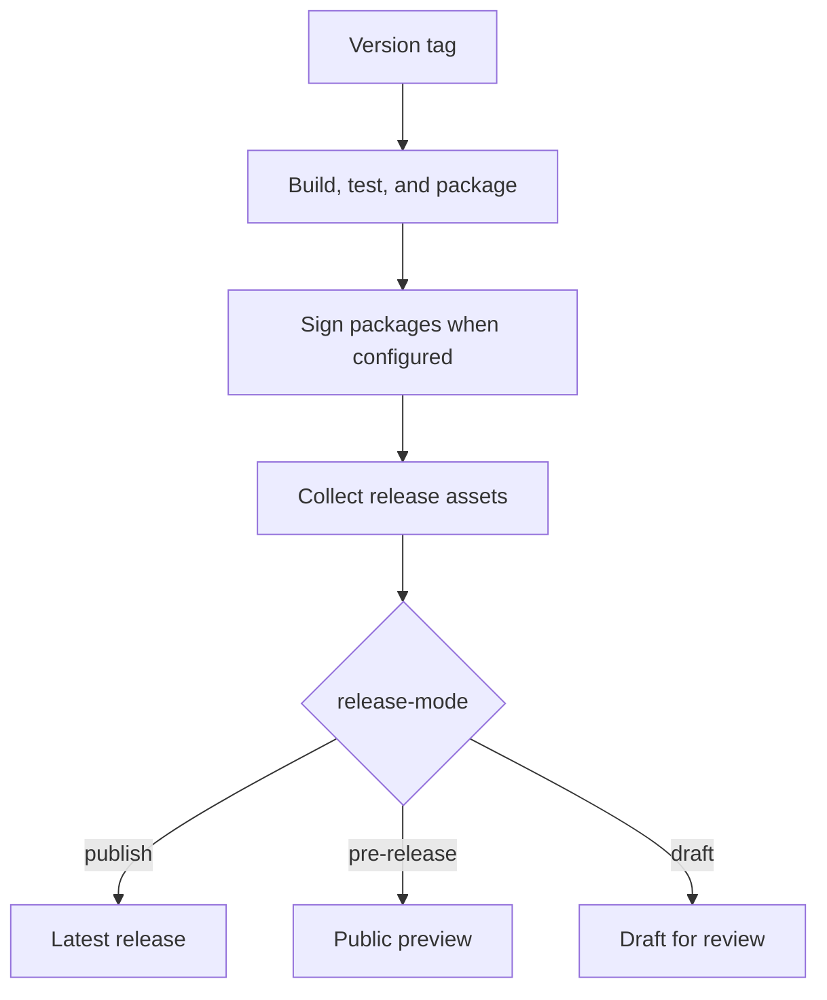
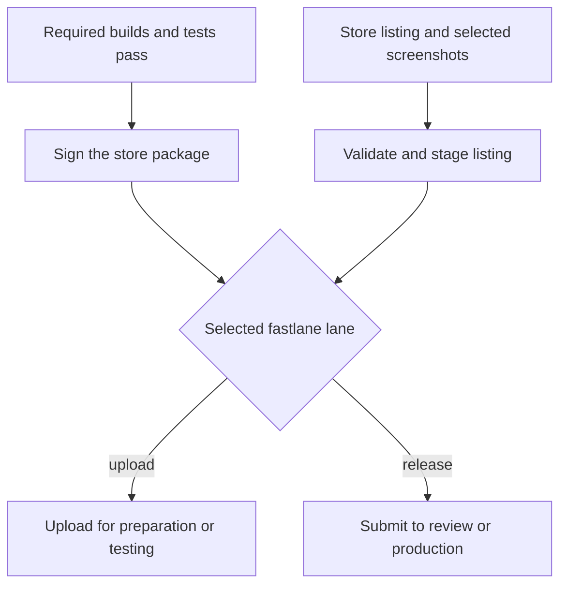
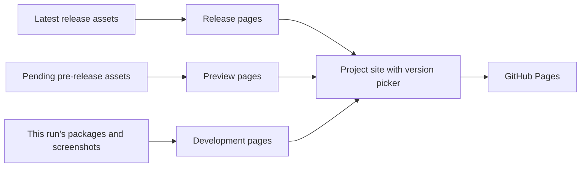

# daybrite/actions

Build, test, package, and publish [Day](https://daybrite.dev) apps with GitHub Actions.
The `dayapp` workflow runs your app across platforms, captures screenshots, and can publish
GitHub releases, upload to app stores, and deploy a project website.

| I want to… | Start here |
|---|---|
| Build an app in CI | [Quick start](#quick-start) |
| Run tests and capture the UI | [Tests and screenshots](#tests-and-screenshots) |
| Distribute a version | [GitHub releases](#github-releases) |
| Upload or submit to a store | [Store uploads](#store-uploads) |
| Host a web app and download page | [Project website](#project-website) |
| Build a demo, flavor, or Rust library | [Flavors and library releases](#flavors-and-library-releases) |
| Add Day steps to an existing workflow | [Individual actions](#individual-actions) |

## Quick start

Add this to your app repository as `.github/workflows/ci.yml`:

```yaml
name: ci
on:
  push:
    branches: ["**"]
    tags: ["v[0-9]+.[0-9]+.[0-9]+*"]
  pull_request:
  workflow_dispatch:

permissions:
  contents: read

jobs:
  app:
    uses: daybrite/actions/.github/workflows/dayapp.yml@v1
    permissions:
      contents: write # Attach packages to GitHub releases on version tags.
    secrets: inherit
    with:
      targets: all
```

`targets: all` reads `[app] targets` from `Day.toml`. You can name a subset instead:
`targets: macos-appkit, linux-gtk, android-material, web-dom`.

By default, the workflow checks formatting, runs `day lint`, builds each target, runs scripts
from `dayscript/*.yaml` (or `scripts/*.yaml`), and packages the app. Each mobile target gets a
phone job and a tablet job. A version tag such as `v1.2.3` also publishes a GitHub release.

The project must build from a fresh checkout. Use registry or Git dependencies for Day;
local paths outside the repository won't exist on the runner. For an app in a subdirectory,
set `project-path: demo`.

The examples below change the calling job's `with:` block unless they show a complete job.
See [dayapp.yml](.github/workflows/dayapp.yml) for every input, default, and signing secret.

## Tests and screenshots

Use Rust tests for application logic and DayScript for interactions with the running app.
Preflight checks run once on Ubuntu before the platform jobs start. Each platform job then
builds the app and runs its scripts on a desktop, simulator, emulator, or browser.



For example, run Rust tests before checking the UI in light and dark themes, in English and
French:

```yaml
with:
  targets: macos-appkit, ios-uikit, android-material, web-dom
  preflight-checks: fmt clippy test
  scripts: dayscript/walkthrough.yaml
  themes: light dark
  locales: en fr
```

The walkthrough runs four times per device: once for each theme and locale pair. Its
`screenshot:` steps capture the UI. Use `locales: all` to cover every locale the app ships.

| Input | Use it to… |
|---|---|
| `scripts: none` | Build and package without running DayScript. |
| `target-scripts` | Choose scripts per target, such as `web-dom: dayscript/browser.yaml`. |
| `scripts-once` | Run selected scripts once, after the theme/locale runs, in the order listed. Useful for tests that consume saved state. |
| `fast-scripts: false` | Keep decorative animation timing for animation tests. |
| `capture-size: 2880x1800@2` | Set desktop and browser screenshot dimensions. |
| `launch-env: DEMO_DATA=1` | Pass environment variables to each scripted launch. Values cannot contain spaces. |
| `script-setup` | Start a local test service or configure emulator ports before scripts run. |
| `grant-permissions` | Grant device permissions before launch, such as `android-material: camera microphone`. |

### Device profiles

Mobile targets use a portrait phone and a landscape tablet by default. Set `ios-devices`,
`android-devices`, or `harmony-devices` to replace that target's device list:

```yaml
with:
  targets: ios-uikit, android-material
  ios-devices: |
    device=iPhone * Pro Max, orientation=portrait, slug=iphone
    device=iPad Pro 13-inch, orientation=landscape, slug=ipad
  android-devices: |
    device=medium_phone, os=36, orientation=portrait, slug=phone
    device=medium_tablet, os=36, orientation=landscape, slug=tablet
```

Each line creates a parallel job. The first device also produces the target's packages;
additional devices produce screenshots and reports. A single line runs just one device.

iOS device names match prefixes and `*` wildcards; omit `os` to use the installed runtime.
Android names must exist in the runner's `avdmanager list device` catalog. HarmonyOS accepts
`phone`, `tablet`, or a pixel size such as `1280x800`; its tablet profile tests a wide layout
while the emulator still identifies as a phone.

### Results and failures

The run's **Artifacts** include `dist-<target>` packages and `screenshots-<target>` captures.
Additional devices add their slug to the screenshot artifact name. The DayScript summary
shows step outcomes, duration, and sampled memory. Available reports upload even when a job
fails; older Day versions without report support are listed as unavailable.

A failed required build or walkthrough blocks releases, signing, store uploads, and website
deployment. Use **Re-run failed jobs** after addressing the failure. After upgrading the
workflow reference, start a new run or use **Re-run all jobs** to pick up the new workflow.

For exploratory coverage, `optional=true` lets an additional device fail without failing the
run. `tolerate-failures: true` also permits failures in designated coverage work, including
macOS GTK/Qt scripts and HarmonyOS emulator runs. It does not ignore every test failure.

### Which Day version is tested?

The default `day-deps: auto` chooses dependencies by event and matches the CLI to them:

| Event | Day dependencies |
|---|---|
| Branch push or pull request | Default branches of Day and its pieces and parts |
| Version tag, scheduled run, or manual run | Newest published versions allowed by the project's requirements |

Set `day-deps: published` or `day-deps: main` to make that choice explicit. Use `locked` to
keep the manifest and lockfile unchanged, or a full Day commit SHA to pin Day within a `main`
build. The workflow resolves dependencies once for all platform jobs.

To check compatibility with published Day releases nightly, add this under `on:`:

```yaml
schedule:
  - cron: "0 7 * * *"
```

## GitHub releases

A `vX.Y.Z` tag builds the app and attaches its packages to a GitHub release after all required
builds and walkthroughs pass. Configured signing runs before the packages are published.



| `release-mode` | Result |
|---|---|
| `publish` (default) | Publish the release and make it latest. |
| `pre-release` | Publish a preview while latest download URLs keep pointing to the previous release. |
| `draft` | Assemble a draft for someone with repository write access to review and publish. |

For a preview release, add `release-mode: pre-release`. To rebuild the project website when
you later promote it to a release, also add this trigger under `on:`:

```yaml
release:
  types: [released]
```

That promotion run rebuilds and deploys the website; it doesn't upload to stores or assemble
another release. The `github-pages` environment must allow deployments from the tag.

**Release mode only controls the GitHub release.** Configured store uploads still run on the
tag, including for drafts and pre-releases. Set `upload-ios: "false"`, `upload-macos: "false"`,
and `upload-play: "false"` when you want to hold those uploads.

### Release downloads

Package filenames include the target and omit the version, so a latest-download link stays
stable, for example:
`https://github.com/<owner>/<repo>/releases/latest/download/my-app-android-material.aab`.

| Release asset | Contents |
|---|---|
| Platform packages | Installers and archives listed in [Targets](#targets). |
| `screenshots.tar.xz` | All captured screenshots, with a merged index. |
| `screenshots-<target>[-<device>].tar.xz` | Screenshots from one target/device job. |
| `gallery.json`, `storefront.json` | Screenshot index and exported store listing data. |
| `SHA256SUMS` | Checksums for release assets. |
| Package sidecars | Build provenance and software bills of materials for `day rebuild`. |
| `launch.sh`, `launch.ps1` | Launchers for the desktop packages the release includes. |

Extract and verify a screenshot bundle with:

```sh
day screenshot unpack screenshots.tar.xz --out screenshots
```

Desktop launchers let someone try a release without installing a toolchain. They ask before
downloading and running the app:

```sh
curl -fsSL https://github.com/<owner>/<repo>/releases/latest/download/launch.sh | bash
```

On Windows, use:

```powershell
irm https://github.com/<owner>/<repo>/releases/latest/download/launch.ps1 | iex
```

### Signing

Branch and pull request builds use development signing where available; device IPAs are
unsigned. On version tags, supplied certificates and keys enable release signing. A signer
with incomplete credentials fails the release. Build and test jobs do not receive signing keys.

For signed and notarized macOS downloads, set `signing-environment: release-signing` and put the
macOS signing secrets in that GitHub environment. Store package credentials are repository
secrets, forwarded through `secrets: inherit`.

<details>
<summary>Signing and upload secrets</summary>

| Destination | Secrets |
|---|---|
| macOS downloads | `DAY_MACOS_CERT_P12`, `DAY_MACOS_CERT_PASSWORD`, `DAY_SIGN_MACOS_IDENTITY`, `DAY_NOTARY_KEY_ID`, `DAY_NOTARY_ISSUER`, `DAY_NOTARY_KEY_B64` |
| iOS signing | `DAY_APPLE_CERT_P12`, `DAY_APPLE_CERT_PASSWORD`, `DAY_IOS_PROFILE_B64` |
| Mac App Store signing | `DAY_MAS_CERT_P12`, `DAY_MAS_CERT_PASSWORD`, `DAY_MAS_PROFILE_B64` |
| Apple uploads | `DAY_APPLE_TEAM`, `DAY_ASC_KEY_ID`, `DAY_ASC_ISSUER`, `DAY_ASC_KEY_B64` |
| Android signing | `DAY_ANDROID_KEYSTORE_B64`, `DAY_ANDROID_KEY_ALIAS`, `DAY_KS_PASS`, `DAY_KEY_PASS` |
| Google Play uploads | `DAY_PLAY_JSON_KEY` (JSON contents) |
| HarmonyOS signing | `DAY_OHOS_KEYSTORE_B64`, `DAY_OHOS_CERT_B64`, `DAY_OHOS_PROFILE_B64`, `DAY_OHOS_KEY_ALIAS`, `DAY_OHOS_KS_PASS`, `DAY_OHOS_KEY_PASS` |

Apple provisioning profiles can also be issued using the App Store Connect key and team.
The Mac App Store `.p12` must contain both Apple Distribution and Mac Installer Distribution
identities. See [sign-package inputs](.github/actions/sign-package/action.yml) for details.

</details>

## Store uploads

On version tags, the workflow can upload iOS, macOS, and Android packages to their stores.
It uses `store/storefront.toml` to generate fastlane lanes, or runs your existing Fastfile.
Uploads auto-enable when the listing or lane and the required upload credentials are present.
The Mac App Store listing must explicitly name `mac-app-store`.



For an app with store listings and signing/upload secrets configured:

```yaml
with:
  targets: ios-uikit, macos-appkit, android-material
  upload-ios: "true"
  upload-macos: "true"
  upload-play: "true"
  ios-upload-lane: ios upload
  macos-upload-lane: mac upload
  play-upload-lane: android upload
```

The `upload-*` inputs are strings: use quoted `"true"` or `"false"`. Enabling an upload without
its signing credentials fails the run.

The generated lanes distinguish uploading a build from submitting it:

| Store | Default lane | To submit |
|---|---|---|
| iOS App Store | `ios upload`: upload without review submission | `ios release`: upload and submit for review |
| Mac App Store | `mac upload`: upload without review submission | `mac release`: upload and submit for review |
| Google Play | `android upload`: draft on the internal track | `android release`: completed release on the production track |

For example, change `ios-upload-lane` to `ios release` when the tag should also submit the app
for review. A custom Fastfile controls its own behavior; it receives the package as `DAY_IPA`,
`DAY_PKG`, or `DAY_AAB`.

### Store screenshots

Uploads leave existing store screenshots alone by default. To replace them with this run's
captures, set `store-screenshots: true` and select screenshot step names in
`store/storefront.toml`:

```toml
[storefront.ios-uikit.apple-app-store.screenshots]
iphone = ["home", { name = "editor", theme = "dark" }]
ipad = ["home", "editor"]

[storefront.android-material.google-play-store.screenshots]
default = ["home", "editor"]
```

Run the scripts in the selected themes and locales. The workflow checks the captures against
[store rules](.github/actions/store-rules/store-rules.toml) before upload. The default mobile
profiles support this flow; Android tablet captures are scaled during staging to meet the store
size requirement. Missing captures or invalid sets fail the upload with a reason.

Automatic screenshot placement requires the generated lanes. If you supply a Fastfile, it must
handle screenshot placement. See the [store listing guide](https://daybrite.dev/docs/store#screenshots)
for listing configuration.

## Project website

Set `deploy-web: true` with `web-dom` in `targets` to host the web app on GitHub Pages.
Add `website/site.toml` to publish a [daysite](https://github.com/daybrite/daysite) project site
with downloads, a screenshot gallery, and the web app:

```toml
# website/site.toml
host = "https://<owner>.github.io/<repo>"
```

Give the calling job Pages permissions:

```yaml
jobs:
  app:
    uses: daybrite/actions/.github/workflows/dayapp.yml@v1
    permissions:
      contents: write
      pages: write
      id-token: write
    secrets: inherit
    with:
      targets: all # Include web-dom in Day.toml.
      deploy-web: true
```

In repository settings, set **Pages → Source → GitHub Actions**. For tag deployments, also
allow your version tags in **Environments → github-pages → Deployment branches and tags**.



Each release page uses that release's packages and screenshots. Development pages use the
current run's artifacts and carry a development notice. A pending pre-release gets a separate
tab. Use `tab-release`, `tab-pre-release`, and `tab-main` to choose which tabs appear.

The project site deploys on default-branch pushes and version tags after the required builds
pass. Without `website/site.toml`, `deploy-web` publishes the bare web app on default-branch
pushes. Set `web-deploy-tag-pattern` to restrict automatic deployment to matching tags.

Use `daysite-version` to pin the template. Themes and other site settings belong in
`website/site.toml`; see the [app website guide](https://daybrite.dev/docs/websites) and
[daysite customization guide](https://github.com/daybrite/daysite/blob/main/docs/customization.md).

If you call `dayapp` twice in one run, set `deploy-website: "false"` on the second call and
let one call own release publication with `release-assets: false` on the other.

## Flavors and library releases

Build a free, paid, or customer-specific version by adding a `Day-<name>.toml` beside `Day.toml`:

```yaml
with:
  targets: all
  flavors: paid
  release-flavor: paid
  store-flavor: paid
```

`flavors` adds builds alongside the base app. `release-flavor` attaches that flavor's packages
to the GitHub release; `store-flavor` selects its packages and listing for store uploads.
Omit those two inputs to keep the extra builds as CI artifacts. See
[build flavors](https://daybrite.dev/docs/flavors) for the app configuration.

For a piece or part with a demo app, build the demo and publish the library from the same tag:

```yaml
jobs:
  app:
    uses: daybrite/actions/.github/workflows/dayapp.yml@v1
    permissions:
      contents: write
      id-token: write
    with:
      targets: all
      project-path: demo
      publish-crates: true
```

Before using `publish-crates`, configure each crate's Trusted Publisher with this repository,
the calling workflow filename, and environment `release`. New crates need an initial publication
before Trusted Publishing can be configured. Versions come from the manifests. The action
publishes in dependency order and skips versions already on crates.io, so interrupted runs can
resume. Use `publish-crates-paths` for multiple workspaces.

For desktop self-updates, `post-pack-command` can stage helper files and update metadata.
`update-signing: true` signs that metadata after platform signing; `macos-update-zip` adds a
signed update archive. Configure `update-public-key`, `update-application-id`, and
`DAY_UPDATE_PRIVATE_KEY` in the signing environment. See the
[workflow inputs](.github/workflows/dayapp.yml) and
[sign-updates action](.github/actions/sign-updates/action.yml) for the metadata requirements.

## Individual actions

Use these actions as steps when you already have a workflow. Each link lists its inputs and
outputs.

| Action | Purpose |
|---|---|
| [setup-day-deps](.github/actions/setup-day-deps/action.yml) | Install a target's libraries, SDKs, and optional packaging tools. |
| [setup-day-cli](.github/actions/setup-day-cli/action.yml) | Install a released CLI, build one from Git, or download a run artifact; export `DAY_BIN`. |
| [day-deps](.github/actions/day-deps/action.yml) | Select published, main, or locked Day dependencies before Cargo commands. |
| [sign-package](.github/actions/sign-package/action.yml) | Sign an existing iOS, Android, HarmonyOS, or Mac App Store package. |
| [store-upload](.github/actions/store-upload/action.yml) | Stage a listing and run a fastlane lane with a signed package. |
| [publish-crates](.github/actions/publish-crates/action.yml) | Publish workspace crates through Trusted Publishing. |
| [sign-updates](.github/actions/sign-updates/action.yml) | Sign desktop update metadata. |
| [dayscript-report-summary](.github/actions/dayscript-report-summary/action.yml) | Summarize DayScript reports in the GitHub run. |

For example, run a library's host tests against published Day dependencies:

```yaml
jobs:
  test:
    runs-on: ubuntu-latest
    permissions:
      contents: read
    steps:
      - uses: actions/checkout@v7
      - uses: dtolnay/rust-toolchain@stable
      - uses: daybrite/actions/.github/actions/day-deps@v1
        with:
          day-deps: published
      - run: cargo test
```

## Targets

| Target | Runner | Packages / test environment |
|---|---|---|
| `macos-appkit` | `xcode-27` | `.dmg`; native desktop |
| `ios-uikit` | `xcode-27` | `.ipa`; iOS Simulator |
| `linux-gtk`, `linux-qt` | `ubuntu-latest` | `.flatpak` and `.appimage`; virtual display |
| `windows-winui` | `windows-latest` | `.msix` and NSIS installer; native desktop |
| `android-material` | `ubuntu-latest` | `.apk` and `.aab`; Android emulator |
| `harmony-arkui` | `ubuntu-latest` | `.hap`; Oniro emulator |
| `web-dom` | `ubuntu-latest` | Web distribution ZIP; headless Chromium |
| `macos-gtk`, `macos-qt` | `xcode-27` | Build and script coverage; packaging unavailable |

Use `target-packages` for extra system dependencies and `target-setup` for commands before a
target builds. `setup-command` is for generating a project during the run; it skips preflight,
dependency resolution, and the clean-checkout check.

Windows runners have no audio endpoint, so scripts that require audio-only playback need a
platform skip. HarmonyOS WebView support and emulator limitations are described in
[setup-harmony-webview](.github/actions/setup-harmony-webview/README.md).

This repository's [validation workflow](.github/workflows/validate.yml) scaffolds a fresh app
and checks the reusable build/package workflow on the primary targets.
